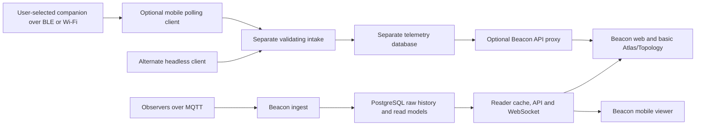

# Beacon project roadmap and maintainer handoff

**Snapshot: 23 October 2026.** Scope: seven org repositories, seven related forks, all 25 pre-existing open issues and 34 open PRs, current main/dev/dev1 source, and fresh read-only production/dev/dev1/Canadaverse runtime checks. This review also finishes the bounded Topology follow-up already in progress. Tracking issue: [beacon-docs #45](https://github.com/MeshCore-Beacon/beacon-docs/issues/45).

## Decision summary

Use one reviewed core server/web candidate and one optional collection candidate. Do not merge every open feature branch in date order. Most of the Atlas/Topology/backend drafts are overlapping generations of the same work, and a green old build is not proof of compatibility with the current database baseline.

The recommended sequence is: establish reliable acceptance capacity and repair build-tool qualification; review the core database/reliability changes; qualify basic Atlas and Topology on the paired backend; rehearse production migration/recovery and soak; then promote an immutable core release. Mobile collection follows a separate intake/RF/device gate. A cursor-only hotfix remains an independent option if the full feature release takes longer.

The main blockers are concrete: dev1 is stopped, live still fails four large-cursor reads, preview is under severe shared-host I/O pressure, a Vite dependency PR has failed CI, development dependencies have current advisories, and the telemetry client has not completed fresh physical/background qualification. None is resolved by consolidating PR titles or declaring the preview a release.

This is a portfolio review with targeted source, regression, query-plan and runtime validation. Every open issue/PR has a disposition below. It is not a claim of an independent line-by-line approval of every historical diff or a production-scale load/security audit of every component.

## Environments: source, branch and runtime are separate facts

| Environment | Verified state before this review's preview update | Consequence |
| --- | --- | --- |
| live.meshcore.ca | Server `202acc6`, web `19f604e`; PostgreSQL 16.14; three migration records; containers running | Ordinary sampled reads work, but the four large-cursor probes return 500. Topology/catalogue endpoints are absent. Do not mistake current dev's fixes for a live deployment. |
| dev.meshcore.ca | Server `0801411`, web `008b2af`; PostgreSQL 16.15; schema 053; running | Backend matches current upstream dev. Web is one source commit behind `811f843`. Read models are complete. Topology is not merged here; its 404 is expected. |
| dev1.meshcore.ca | Four service containers stopped; sampled public requests all return 502 | Stored labels refer to server `b53e3c6` and web `5345519`. The database's current migration journal could not be read while stopped. Do not infer it from a branch name or count the error object as one migration. |
| Canadaverse preview | Started this review at server `fdae02d`, web `79edb9c`, label 2.5.0-n30nex.1; schema 053 | Has core/optional features plus preview extras. Fresh audit exposed load problems despite the prior successful qualification. Updated candidate identities and post-deploy results are recorded in the completion section. |

Org branch heads at inventory: server main/dev1 `202acc6`, dev `0801411`; web main `19f604e`, dev `811f843`, dev1 `add7acb`; docs main `2731999`, dev `3c2ffe2`; canonical Flutter main `5a3de51`, dev `a810704`. A stopped dev1 container is also different from the org dev1 branch: neither currently represents the complete new core candidate.

No production/dev/dev1 configuration, data or service was changed. Production checks were read-only and bounded. The separate preview worker retains the radio; RemoteTerm remains suspended. Private credentials, raw production logs and database dumps are not included in the public handoff.

## Repository responsibilities

| Repository / lane | Role and disposition |
| --- | --- |
| MeshCore-Beacon/beacon-server | Authoritative ingest, database/sqlc/read models, API, cache and stream contracts. Core #266/#267 are the review lane; optional #268/#269 add only the validating intake proxy/capability above it. |
| MeshCore-Beacon/beacon-web | Basic Atlas, packet/observer views and Topology. Core #182/#183; optional telemetry #184/#185. Keep frontend types and retry/cursor behavior paired with the backend. |
| MeshCore-Beacon/beacon-flutter-app | Canonical mobile app, now public. #11 is the optional collection branch. #5 is a separate CI-action maintenance update. There is no upstream app dev1 branch. |
| MeshCore-Beacon/beacon-docs | Authoritative technical/operator documentation and this roadmap. #43 is the core/roadmap qualification lane; #44 is optional collection. |
| MeshCore-Beacon/beacon-agent | Private scaffold, not a deployable replacement for intake or the current headless client. Define its ownership and contract before moving working service code here. |
| MeshCore-Beacon/beacon-scratch | Optional rough planning space. Its permissive dev workflow is not the promotion policy for the application repositories. |
| MeshCore-Beacon/beacon-flutter-app-archive | Legacy private mobile repository; despite its name, the repository is not formally archived. Decide whether to archive it after preserving needed history. Do not maintain a second release lane by habit. |
| n30nex/beacon-server-contributions and beacon-web-contributions | Active preview integration on the explicitly named n30nex-test branches. Default branches are not reliable deployment identifiers. Keep preview-only changes distinguishable from the org core. |
| n30nex/beacon-docs-contributions | Historical/shared experimental documentation; n30nex-test has advanced independently. Preserve Torchlight history and port relevant current docs through the org dev workflow. |
| n30nex/beacon-flutter-app | Test-build fork for canonical app #11. The tested collection head is `1f70418`, version 2.1.0+3. |
| n30nex/Beacon-Telemetry-Collector | Private, separate intake plus alternate headless client; head `386db29`. The app replaces a polling client, not this intake/storage responsibility. Preserve the private-source boundary and existing license. |
| n30nex/beacon-server and n30nex/beacon-web | Legacy forks, not current deployment sources. Retain recoverable unpublished work; exclude them from automatic release composition. |

Some local clones use narrow fetch refspecs. A generic fetch left a server origin/n30nex-test tracking ref at `527efa4` even though the actual remote was `fdae02d`. The current work resolved the named remote ref explicitly before integration. Operators should compare the actual remote SHA, not trust a stale local remote-tracking name.

## Architecture and promotion boundary

Observer MQTT ingestion and companion telemetry are different contracts. Keep their clocks, identities, acknowledgment semantics, retention and evidence labels separate. No admin password or companion private key should leave the client. Signed enrollment establishes key possession, not hardware attestation or sensor truth.

The working promotion path is preview experimentation -> reviewed org dev composition -> a usable dev1 acceptance environment -> paired immutable release/main -> operator deployment to live. The current application PRs also have explicit dev1 targets because the operator requested that review route. Review the dev-targeted source first, then reconcile the paired dev1 target; do not accept divergent copies of a feature on both branches.

## Roadmap: ordered packages and exit gates

| Package | Work / owner by role | Exit gate |
| --- | --- | --- |
| R0. Restore acceptance capacity | Release/preview operators: decide dev1 maintenance/recovery, inspect its actual database before starting the candidate; measure shared Pi pressure and isolate suspected legacy load only with operator authorization. | A named reference environment is healthy, capacity is known, the exact source/schema/config manifest is recorded, and a rollback can be executed without resetting traffic history. |
| R1. Core reliability and build hygiene | Backend/web reviewers: core #266/#267 + #182/#183; current baseline/cursors/read models, bounded first fills, post-start history work, cache/error/stream bounds, supported runtime; fix build-tool advisories and qualify #186. Docs/operator: bounded logs and measured pool/cache settings. | Combined native CI, PostgreSQL/race/vulnerability/plan checks, exact cursor walks and restored-copy migration pass; no unhandled test errors; all unresolved advisories have a documented disposition. |
| R2. Basic Atlas and Topology acceptance | Web/backend reviewers: saved node/observer cards, lazy details, sample/gap labels, trace provenance, bounded feed and rendering; follow-up summary/read-model work only where measured. | Desktop and narrow-screen journeys pass; real target-device frame/interaction measurements and cold/warm API checks meet agreed budgets without hiding nodes, dropping distinct paths or disabling useful live effects. |
| R3. Time, data quality and delayed replay | Backend/protocol owners: #231/#270 sender/observation/receipt policy; #229 configurable evidence policy above structural safety; define replay age/order/rate, dedup lifetime and acceptance receipts. | Original timestamps/raw evidence preserved; future/late data do not pollute sorting, rollups, routes or retention; supported producer contract is versioned and tested before producers replay outages. |
| R4. Core production promotion | Release owner: representative production-shaped restore and migration from the actual live baseline, maintenance-cycle soak, operational metrics/alerts, exact release artifacts and recovery rehearsal. | Paired release manifest approved; operator signs off migration, source/artifact identity, client floors, SLOs, rollback/RPO/RTO and a monitored release window. Production is not the first integration test. |
| R5. Optional mobile telemetry alpha | Mobile/intake/web owners: #11 + server #268/#269 + web #184/#185 + docs #44; select/enroll nodes, BLE/Wi-Fi, background controls, durable delivery, coverage, budgets and service ownership. | Physical reconnect/unlock/screen-off/notification/overnight tests and actual mobile-to-Atlas delivery pass; shared RF coordination and intake operating model accepted; optional service failure leaves basic Beacon usable. |
| R6. Operator and long-term scale features | Owners after the core: remaining #60/#72 account/login/import/remote backup scope, map defaults, Atlas summary/downsampling contract, observer controls and a deliberate beacon-agent transition. | Small independent requirements and acceptance tests; no speculative control channel or destructive import added to the release merely because an old issue mentions it. |

R3 contains policy work that can proceed alongside R1/R2; do not block an isolated bigint cursor repair on completing a new replay protocol. Basic Atlas can be accepted without collected telemetry. If Topology's hardware/load gate takes longer, use the existing tab configuration to stage its visibility deliberately; do not silently enable an unqualified page in a production release.

Suggested performance acceptance targets, **proposals for the maintainer to agree, not measured guarantees**: warm route snapshot p95 <=250 ms on the reference host and <=1 s through the public proxy; cold global 24h snapshot p95 <=5 s on a production-sized retained dataset; ordinary packet/message reads remain responsive during fills/cleanup; target-device interaction remains usable with a 30-frame/s render budget at the representative graph size. Test the maximum caps separately. Record hardware, dataset, cold/warm state and measurement method. A frame cap is not an achieved FPS, and a few timings are not p95.

## Current performance findings and implemented follow-up

The 22/23 October Topology work changed the route query to stream paired adjacent array values with ROWS FROM/unnest. It avoids repeated array subscripting, preserves exact time bounds and NULL gaps, and handles non-one-based arrays correctly. The old expression could manufacture a bridge or lose adjacency with unusual bounds; a PostgreSQL regression now covers it. The cache keeps the whole minute snapshot, canonicalizes duplicate region keys and uses exact bounds. Six Topology plan cases retain indexed time-window drivers; three expected signatures changed from sort-before-group to hashed aggregation before final sorting.

The web now applies its frame budget to camera input as well as animation, skips unchanged idle paints, releases inactive canvas buffers while restoring the camera, indexes observer lookup for chatter, and animates repeated hearings of one exact packet/path once. Every raw report and trail and every distinct path is retained; unique packet effects, glows and Public chatter remain. Extra Path2D caching was tried and removed because its timing benefit was inconsistent.

The native frontend run exposed the same asynchronous fixture failure as Vite #186: all assertions passed, but a delayed TanStack Virtual scroll callback ran after jsdom destroyed window. Test-only commit `c2c3ecb` controls/drains that timer while the environment exists and asserts no timers remain after cleanup. It does not suppress unhandled errors, change production scrolling or remediate dependency advisories. The updated complete preview suite subsequently passed 1,560 tests.

The Pi is not presently a clean performance reference. The fresh audit saw load around 4.6 on four CPUs and, in a later sample, I/O PSI `some avg60=62.61` and `full avg60=35.22`; these are stall-pressure measures, not disk bandwidth/utilization. CoreScope was at about 1.499 GiB of a 1.5 GiB limit and using about 115% CPU. Beacon app and its database were each using only a few percent CPU. This identifies a suspect co-located contributor, not isolated proof of a sole cause. No unrelated workload was stopped.

Under that pressure, 15m/24h Topology public reads exceeded the eight-second audit timeout, and both bounded SQL variants hit a fifteen-second statement timeout. Observer-directory traffic ranking returned 500 after about five seconds. Restored-copy query parity and lower cost do not establish a live-host speedup under this condition. The roadmap must include capacity/isolation and query-family measurements before claiming the cold-query gate is closed.

There were 13 queue/drop-class warning lines in the sampled last-hour preview log tail, plus other warnings. This is neither a drop count nor a loss ratio; inspect the bounded queue metrics and workload together. CMI/packet-sites were complete, so an unfinished first fill is not an adequate explanation for all current latency.

The current core npm audit reports four affected dependency entries (Vite, Vitest, @vitest/mocker and Zod; two high and two moderate entries). Production-only `npm audit --omit=dev` reports zero. Treat these as development/build-tool exposure requiring an updated qualified lockfile, not evidence that the static site is compromised. Public advisories: [launch-editor](https://github.com/advisories/GHSA-587h-7wmj-h5pm), [Vitest](https://github.com/advisories/GHSA-qxg6-89mg-rqv8), [Zod](https://github.com/advisories/GHSA-mrhx-c7xc-m3w5). Counts are tool-entry counts, not unique exploit counts.

## Operating and data-contract work that remains

- **Cold snapshots and Atlas fanout:** measure the query family, cache occupancy and client request budget. If a shared/precomputed adjacent-link model is warranted, define as-of metadata, exact expiry/reference counts, regional isolation and full result parity before making it authoritative. Do not remove the current query-plan gates or hide stale data. Atlas's recent 200-report sample remains a sample, not a complete lifetime/24h count.
- **Failure semantics:** finish the retryable-error review across read handlers. Observer-directory currently maps its read error to generic 500; the Topology-specific 503/Retry-After work does not fix every sibling endpoint. Bound shared background fetch work as well as the HTTP caller's wait.
- **Diagnostics and budgets:** privately enable/scrape the supported metrics and PostgreSQL statement/IO diagnostics through a planned change. Preserve reset timestamps and avoid raw values in labels. Budget all API/slow/maintenance/ingest/intake connections together, including backups and operator headroom; connection isolation alone does not isolate storage bandwidth.
- **Retention and recovery:** preserve deployment-specific raw/rollup/observer/route policies and the separate intake retention. Do not use an image-only rollback across schema 053's incompatible removals. The preview's off-host restore is useful evidence, but it is not production-sized role/ownership/RPO/RTO qualification.
- **Privilege and proxy boundaries:** separate migration/maintenance ownership from runtime authority on a restored copy before revoking privileges; keep metrics/admin private and trust only the actual proxy peers. Do not expose credentials or make every mounted directory writable to accommodate the nonroot image.
- **Clock/replay contract:** outer observer-time clamping is not decrypted sender-time validation. Preserve both clocks and an explicit effective ordering time. MQTT PUBACK is not a Beacon storage receipt. Companion report acceptance is a separate signed protocol and must not be advertised as an observer replay contract.
- **RF and mobile:** local hourly budgets cannot globally coordinate independent clients/instances. A closed repository does not itself enforce RF policy. Keep device reservations, no catch-up bursts, congestion/route limits, honest session/key-possession claims and explicit physical qualification.
- **Operations hygiene:** the three deployment templates now have only a bounded Docker logging change (11 services, json-file 10m/3). Existing containers require planned recreation to adopt it. Caddy access logs, database/WAL/backup growth and remote backup schedules are separate concerns. Data volumes are unchanged.

## Merge and release procedure

1. Agree the reference environment and core/optional boundaries in docs #45. Review the dev-targeted core PRs first; use the paired dev1 PRs as the corresponding acceptance candidate, not a second divergent implementation.
2. Resolve development dependency advisories and the exact dependency candidate's CI. Apply the small teardown fix where needed; do not mark an old failed run green because assertions passed.
3. Accept the current core source with its compatibility floors, schema/runbook and tests. Reconcile the optional branches against accepted core so their review diff contains the optional contract rather than re-presenting the whole core.
4. Rehearse migration/read-model initialization, interruption, retention and recovery against a representative copy of the actual release baseline. Check all four large-cursor endpoints and multi-page boundaries, not just health/info.
5. Deploy a paired immutable candidate to authorized dev/dev1, prove image/binary/assets/config/schema identity, then soak through at least a real maintenance cycle with API latency, database WAL/temp work, queues and read-model trust together.
6. Approve the release scope and immutable artifacts before the operator changes live. Keep the rollback/recovery boundary explicit. Monitor the same acceptance probes after rollout and record what was actually deployed.
7. Close/supersede old PRs/issues only after the accepted source and runtime evidence satisfy their scope. Preserve unpublished history and old recovery copies; do not delete branches/worktrees as a substitute for triage.

## Acceptance checklist for the other maintainer

- [ ] One chosen core server/web SHA pair, all required checks current on those heads; optional delta separately reviewable.
- [ ] Dev1 available and its actual database state recorded; no assumption that a stored image label or branch equals the running system.
- [ ] Production-shaped schema 003-to-053 migration/recovery rehearsal, writable mount/role/extension checks and exact opaque cursor walks.
- [ ] Cold/warm route, normal reads, fills/cleanup and ingestion budgets measured on a reference workload; no false losslessness, FPS or p95 claim.
- [ ] Atlas saved-state, observer coverage, sparse charts, keyboard/phone/French journeys; Topology camera/fullscreen/hidden-tab/chatter/path-evidence behavior.
- [ ] Current dependency advisory disposition and clean full CI, including absence of asynchronous errors.
- [ ] Private metrics/alerts, container/disk/connection budgets, bounded logs and production restore/RPO/RTO owners.
- [ ] Optional intake is deployed/operated separately; radio/device/background and cross-client budget gates passed before wider enrollment.
- [ ] Operator-approved release and rollback window; final source/artifact/config/schema manifest and post-write proof recorded.

The issue and PR inventories below are explicit disposition lists. “Covered in candidate” does not mean “accepted” or “deployed live.” “Keep open” identifies scope still missing, rather than suggesting the previous work did nothing.

## Every pre-existing open issue

| Issue | Title | Disposition / next acceptance |
| --- | --- | --- |
| [MeshCore-Beacon/beacon-docs #13](https://github.com/MeshCore-Beacon/beacon-docs/issues/13) | Bound Docker container logs in all deployment templates | Bounded json-file logging prepared in #43 for all 11 services; semantic YAML checks pass. Runtime adoption requires planned container recreation. |
| [MeshCore-Beacon/beacon-flutter-app #10](https://github.com/MeshCore-Beacon/beacon-flutter-app/issues/10) | Optional companion telemetry sharing with a compatible Beacon instance | R5 via #11 plus optional API/web/intake; Android background scope now exceeds the original foreground-only issue text. Hardware/RF coordination gates remain. |
| [MeshCore-Beacon/beacon-flutter-app #4](https://github.com/MeshCore-Beacon/beacon-flutter-app/issues/4) | Region selector button missing in portrait orientation | R2/R5 open: reproduce portrait region controls on the current canonical app; old store build report is not proof of a current fix or failure. |
| [MeshCore-Beacon/beacon-server #270](https://github.com/MeshCore-Beacon/beacon-server/issues/270) | Supported producer contract for delayed observer MQTT packets | R3: define supported replay, clock, dedup and receipt contracts; implementation behavior is not a producer guarantee. Source-backed comment posted. |
| [MeshCore-Beacon/beacon-server #265](https://github.com/MeshCore-Beacon/beacon-server/issues/265) | Consolidate backend performance and reliability for the Atlas/Topology release candidate | R1 coordinator: review #266/#267 and the paired web; keep operational acceptance separate from merge status. |
| [MeshCore-Beacon/beacon-server #258](https://github.com/MeshCore-Beacon/beacon-server/issues/258) | Recheck Redis after a late miss becomes the singleflight leader | Covered by #259 and core #266/#267; close after the chosen accepted source includes the late-miss regression. |
| [MeshCore-Beacon/beacon-server #254](https://github.com/MeshCore-Beacon/beacon-server/issues/254) | Avoid empty HTTP 200 responses when JSON encoding fails | Covered by #255 and core #266/#267; require JSON-error regression in accepted source. |
| [MeshCore-Beacon/beacon-server #252](https://github.com/MeshCore-Beacon/beacon-server/issues/252) | Bound read-model backfill writes and retry smaller slices under pressure | Covered by #253 and core #266/#267; require bounded-write/interruption tests and target-load qualification. |
| [MeshCore-Beacon/beacon-server #231](https://github.com/MeshCore-Beacon/beacon-server/issues/231) | Can you remove these chats from the future on YEG beacon? | R3 open: future sender-time ordering is not fixed by outer observation-time clamping. No live deletion performed; policy comment posted. |
| [MeshCore-Beacon/beacon-server #229](https://github.com/MeshCore-Beacon/beacon-server/issues/229) | Add Configurable Topology Validation for Packet Paths and Neighbors | R3 open: structural safeguards are staged; configurable policy, literal byte semantics and aggregate revalidation still need design. |
| [MeshCore-Beacon/beacon-server #226](https://github.com/MeshCore-Beacon/beacon-server/issues/226) | Synchronous channel backfill delayed dev1 startup and live ingestion by about 159 seconds | Post-start resumable history job is in core #266/#267; accept startup/readiness and interruption evidence before closing. |
| [MeshCore-Beacon/beacon-server #224](https://github.com/MeshCore-Beacon/beacon-server/issues/224) | Route reconfirm maintenance repeatedly times out before neighbour revalidation | Current dev/core replace the older maintenance shape; verify backlog progress and a real maintenance cycle before declaring the old starvation report closed. |
| [MeshCore-Beacon/beacon-server #223](https://github.com/MeshCore-Beacon/beacon-server/issues/223) | Suspect TRACE records resolve as confident paths and promote unvisited hops | TRACE ambiguity/width/consumed-hop safeguards are in core; preserve raw evidence and require paired analyzer tests/acceptance. |
| [MeshCore-Beacon/beacon-server #72](https://github.com/MeshCore-Beacon/beacon-server/issues/72) | Backup - local & remote | Keep open for remaining UI/login/import/overwrite/remote-storage scope. Export, validation and protected download foundations already exist; do not rebuild them. |
| [MeshCore-Beacon/beacon-server #60](https://github.com/MeshCore-Beacon/beacon-server/issues/60) | Admin API | Rescope against accepted config/account/CORS code. Ingest worker-pool configuration, persistence, login and tokens are not implied by the existing API. |
| [MeshCore-Beacon/beacon-web #181](https://github.com/MeshCore-Beacon/beacon-web/issues/181) | Consolidate basic Atlas and performant Topology for the core release candidate | R1/R2 coordinator: primary #182/#183, performance and paired API acceptance; optional telemetry stays separate. |
| [MeshCore-Beacon/beacon-web #170](https://github.com/MeshCore-Beacon/beacon-web/issues/170) | Channel list over scroll | R2 open: reproduce Channels nested scrolling/overscroll on current desktop/mobile layouts, especially Safari; add viewport containment regression before closure. |
| [MeshCore-Beacon/beacon-web #163](https://github.com/MeshCore-Beacon/beacon-web/issues/163) | Port the qualified Topology page and bounded backend feed to dev1 | Implementation consolidated in #182/#183 and backend #266/#267; current dev1 deployment acceptance remains open because services are stopped. |
| [MeshCore-Beacon/beacon-web #162](https://github.com/MeshCore-Beacon/beacon-web/issues/162) | Atlas drag can be committed by a different pointer and leak listeners | Drag ownership/cancellation work is included in the core lineage; close after accepted tests and touch/keyboard journeys, not from old PR green status alone. |
| [MeshCore-Beacon/beacon-web #161](https://github.com/MeshCore-Beacon/beacon-web/issues/161) | Sparse sparklines hide isolated signal readings | Isolated readings/zero/gaps have regression coverage in core. Preview shares its bright chart implementation; preserve semantics when promoting. |
| [MeshCore-Beacon/beacon-web #150](https://github.com/MeshCore-Beacon/beacon-web/issues/150) | Make a few map defaults configurable (live map dim level, single IATA tilt, clustering) | R6 partial: preview has a user dimming option, not the full requested per-deployment opacity/pitch/clustering defaults or clustered activity indication. |
| [MeshCore-Beacon/beacon-web #96](https://github.com/MeshCore-Beacon/beacon-web/issues/96) | Add My Atlas saved-node monitoring cards | Basic Atlas is consolidated in #182/#183. Keep sample/coverage semantics; close after saved-state, observer and narrow-screen acceptance. |
| [n30nex/beacon-server-contributions #10](https://github.com/n30nex/beacon-server-contributions/issues/10) | Preserve backfill batch size when only the work-cycle budget expires | Fix present in deployed preview and consolidated core; verify accepted upstream coverage, then close as incorporated. |
| [n30nex/beacon-server-contributions #8](https://github.com/n30nex/beacon-server-contributions/issues/8) | Refresh preview database/API and avoid redundant cache reads | Preview refresh has been deployed; use exact current manifests, then close tracking once the owner accepts the evidence. |
| [n30nex/beacon-web-contributions #16](https://github.com/n30nex/beacon-web-contributions/issues/16) | Refresh preview upstream UI while preserving Atlas telemetry and Topology | Preview refresh is deployed with preserved extras. Close tracking after source/assets/runtime verification; do not infer org acceptance. |

New coordination issue [beacon-docs #45](https://github.com/MeshCore-Beacon/beacon-docs/issues/45) tracks this roadmap. Existing issues were not mass-closed.

## Every pre-existing open PR

| PR | Target / code head (docs via PR) | Disposition |
| --- | --- | --- |
| [MeshCore-Beacon/beacon-docs #44](https://github.com/MeshCore-Beacon/beacon-docs/pull/44) | dev / `see PR` | OPTIONAL collection guide, refresh after core docs acceptance. |
| [MeshCore-Beacon/beacon-docs #43](https://github.com/MeshCore-Beacon/beacon-docs/pull/43) | dev / `see PR` | PRIMARY project roadmap/core qualification/operator docs; includes bounded log templates. |
| [MeshCore-Beacon/beacon-docs #7](https://github.com/MeshCore-Beacon/beacon-docs/pull/7) | main / `93e096f12bb7` | Historical experimental docs targeting main; policy check fails. Port needed content through dev, no bypass. |
| [MeshCore-Beacon/beacon-flutter-app-archive #22](https://github.com/MeshCore-Beacon/beacon-flutter-app-archive/pull/22) | dev / `8392a679f026` | Legacy repository duplicate of canonical action maintenance. Decide archive policy; do not create another release lane. |
| [MeshCore-Beacon/beacon-flutter-app #11](https://github.com/MeshCore-Beacon/beacon-flutter-app/pull/11) | dev / `1f704187a94e` | OPTIONAL mobile collection; native CI passed, physical BLE/Wi-Fi/background gate open. |
| [MeshCore-Beacon/beacon-flutter-app #5](https://github.com/MeshCore-Beacon/beacon-flutter-app/pull/5) | dev / `4ac72a61131f` | Small independent setup-java maintenance update with green CI; review separately from telemetry. |
| [MeshCore-Beacon/beacon-server #269](https://github.com/MeshCore-Beacon/beacon-server/pull/269) | dev1 / `96e29a0c04c1` | OPTIONAL -> dev1, after accepted core and intake/device gates. |
| [MeshCore-Beacon/beacon-server #268](https://github.com/MeshCore-Beacon/beacon-server/pull/268) | dev / `96e29a0c04c1` | OPTIONAL -> dev, after accepted core; review the optional-only comparison. |
| [MeshCore-Beacon/beacon-server #267](https://github.com/MeshCore-Beacon/beacon-server/pull/267) | dev1 / `5c4c53887e91` | PAIRED core -> dev1. Same source lane; actual dev1 acceptance still required. |
| [MeshCore-Beacon/beacon-server #266](https://github.com/MeshCore-Beacon/beacon-server/pull/266) | dev / `5c4c53887e91` | PRIMARY core -> dev. Review current head and release gates. |
| [MeshCore-Beacon/beacon-server #263](https://github.com/MeshCore-Beacon/beacon-server/pull/263) | dev1 / `07188bdfb2ea` | Superseded optional prototype; retain until #268/#269 acceptance. |
| [MeshCore-Beacon/beacon-server #259](https://github.com/MeshCore-Beacon/beacon-server/pull/259) | dev / `14feb220f6a6` | Focused cache fix included in core; choose standalone acceptance or core, not duplicate implementations. |
| [MeshCore-Beacon/beacon-server #256](https://github.com/MeshCore-Beacon/beacon-server/pull/256) | dev1 / `c0abd3e6b374` | Superseded broad dev1 integration; core #266/#267 retain current upstream. |
| [MeshCore-Beacon/beacon-server #255](https://github.com/MeshCore-Beacon/beacon-server/pull/255) | dev / `d2553acd79a3` | Focused JSON fix included in core; retain regression when accepting. |
| [MeshCore-Beacon/beacon-server #253](https://github.com/MeshCore-Beacon/beacon-server/pull/253) | dev / `1f683c9df6d2` | Focused bounded-fill fix included in core; qualify on target storage. |
| [MeshCore-Beacon/beacon-server #242](https://github.com/MeshCore-Beacon/beacon-server/pull/242) | codex/sync-dev1-server-20261015 / `b53e3c67514e` | Legacy dev1 cursor backport; upstream dev/core already include the accepted cursor fix. |
| [MeshCore-Beacon/beacon-server #230](https://github.com/MeshCore-Beacon/beacon-server/pull/230) | dev1 / `5374ee55a3b3` | Older dev1 upstream/Topology sync; superseded by current core. |
| [MeshCore-Beacon/beacon-server #225](https://github.com/MeshCore-Beacon/beacon-server/pull/225) | dev1 / `1d3f7ce6211b` | Original Topology/TRACE port; superseded by core, retain evidence reference. |
| [MeshCore-Beacon/beacon-server #210](https://github.com/MeshCore-Beacon/beacon-server/pull/210) | dev / `b097f19a31cc` | Broad early preview experiment; not the current release source. |
| [MeshCore-Beacon/beacon-server #192](https://github.com/MeshCore-Beacon/beacon-server/pull/192) | dev / `054e08de7d7f` | Experimental fork integration now includes optional work and preview extras. Do not merge as the standalone core. |
| [MeshCore-Beacon/beacon-web #186](https://github.com/MeshCore-Beacon/beacon-web/pull/186) | dev / `b7be0bcd5249` | DEPENDENCY track: failed CI with unhandled virtualizer callback. Test-only fix available; rebase, re-audit and rerun exact candidate. |
| [MeshCore-Beacon/beacon-web #185](https://github.com/MeshCore-Beacon/beacon-web/pull/185) | dev1 / `a6ecbbc25555` | OPTIONAL telemetry -> dev1 after core/intake qualification. |
| [MeshCore-Beacon/beacon-web #184](https://github.com/MeshCore-Beacon/beacon-web/pull/184) | dev / `a6ecbbc25555` | OPTIONAL telemetry -> dev after core/intake qualification. |
| [MeshCore-Beacon/beacon-web #183](https://github.com/MeshCore-Beacon/beacon-web/pull/183) | dev1 / `c2c3ecbba0a1` | PAIRED basic Atlas/Topology -> dev1; requires a running acceptance environment. |
| [MeshCore-Beacon/beacon-web #182](https://github.com/MeshCore-Beacon/beacon-web/pull/182) | dev / `c2c3ecbba0a1` | PRIMARY basic Atlas/Topology -> dev, with performance follow-up. |
| [MeshCore-Beacon/beacon-web #180](https://github.com/MeshCore-Beacon/beacon-web/pull/180) | dev1 / `ff18bd5e84a8` | Older optional telemetry PR; superseded by #184/#185. |
| [MeshCore-Beacon/beacon-web #179](https://github.com/MeshCore-Beacon/beacon-web/pull/179) | dev1 / `b2f025660c24` | Older combined upstream/Atlas/Topology candidate; superseded by core. |
| [MeshCore-Beacon/beacon-web #169](https://github.com/MeshCore-Beacon/beacon-web/pull/169) | dev1 / `5345519ee41d` | Older dev1 sync, used by stored dev1 image; not current core acceptance. |
| [MeshCore-Beacon/beacon-web #167](https://github.com/MeshCore-Beacon/beacon-web/pull/167) | dev1 / `5786dd89fe8b` | Observer/card refinements incorporated into current core lineage. |
| [MeshCore-Beacon/beacon-web #165](https://github.com/MeshCore-Beacon/beacon-web/pull/165) | dev1 / `9209d9388815` | Original Topology/Public-chatter port; superseded by #182/#183. |
| [MeshCore-Beacon/beacon-web #164](https://github.com/MeshCore-Beacon/beacon-web/pull/164) | dev1 / `fee858fd7707` | Sparse-chart/drag fixes incorporated into core; preserve tests. |
| [MeshCore-Beacon/beacon-web #151](https://github.com/MeshCore-Beacon/beacon-web/pull/151) | dev / `add7acbaa1cc` | Earlier basic Atlas PR; org dev1 branch currently points here, but core has later work. |
| [MeshCore-Beacon/beacon-web #148](https://github.com/MeshCore-Beacon/beacon-web/pull/148) | dev / `9d08d9895676` | Broad early preview experiment including extras; do not substitute for separated core/optional lanes. |
| [MeshCore-Beacon/beacon-web #97](https://github.com/MeshCore-Beacon/beacon-web/pull/97) | dev / `91a9541cd6fe` | Original Atlas draft; current core is the maintained review lane. |

## Work completed during this review

- Updated core server #266/#267 and optional #268/#269 with the bounded Topology query/cache follow-up; updated core web #182/#183 and optional #184/#185 with rendering/lifecycle/duplicate-hearing improvements and the test teardown fix. All application candidates retain draft status; no org merge occurred.
- Incorporated preview fork PRs [server #14](https://github.com/n30nex/beacon-server-contributions/pull/14) and [web #20](https://github.com/n30nex/beacon-web-contributions/pull/20) after native CI. The preview now runs server `054e08de7d7fd581e55544e0326ca92596b9a990` and web `8dcb7f2f233c8ac4086c1ebe02f81d348630321b`, label **2.5.1-n30nex.1**. API compatibility version remains 2.1.0.
- Native server build/vet/unit/PostgreSQL/race/plan/runtime-image checks and the full 1,560-test preview web run passed. Six Topology plan cases passed with reviewed signatures. The 18-test virtualizer file now drains its fixture timers rather than suppressing asynchronous errors.
- Restored-snapshot global query medians were **1.3691 s -> 0.9836 s (28.2% lower)**, with identical 9,975-edge output. Dense YYJ and sparse YKF outputs also matched. This is a serialized local snapshot comparison, not a live throughput guarantee. Six CPU-raster scene hashes were identical for unique traffic; repeated hearings intentionally produce fewer duplicate particles while retaining reports/paths.
- All 34 public assets and both corresponding source archives matched the deployed build. Both MQTT brokers and retained telemetry API checks passed, including six histories and invalid-signature/unenrolled-report rejection. Schema 053, configuration/retention, private keys, intake/worker and unrelated container identities remained unchanged.
- A final public 24h route snapshot returned 200 in 5.619 s and then 0.191 s cached, with the same 9,346 links and window. Host pressure was lower than during the earlier timeout sample. These two samples do not close the cold p95 or contention gates or prove the improvement came solely from the code.
- No browser surface was available for a new visual/device run in this session. Existing scene/regression checks are not relabelled as fresh Mac/Safari/phone acceptance. No new mobile RF/background qualification is claimed.
- Prepared bounded Docker log rotation across all three templates/11 services in docs #43. Parsed semantic comparison proves only logging changed. No live container was recreated for that template change.
- Published substantive review comments on [server #266](https://github.com/MeshCore-Beacon/beacon-server/pull/266#pullrequestreview-5635386697), [web #182](https://github.com/MeshCore-Beacon/beacon-web/pull/182#pullrequestreview-5635386963) and [web #186](https://github.com/MeshCore-Beacon/beacon-web/pull/186#pullrequestreview-5635268998); source-backed issue comments on [replay #270](https://github.com/MeshCore-Beacon/beacon-server/issues/270#issuecomment-6376355877), [policy #229](https://github.com/MeshCore-Beacon/beacon-server/issues/229#issuecomment-6376566376) and [clock #231](https://github.com/MeshCore-Beacon/beacon-server/issues/231#issuecomment-6376566638); workflow clarification on [docs #7](https://github.com/MeshCore-Beacon/beacon-docs/pull/7#issuecomment-6376497818); and the isolated test-fix pointer on [web #186](https://github.com/MeshCore-Beacon/beacon-web/pull/186#issuecomment-6376498120). These are comment reviews, not approvals.

## Next operator decisions

Agree the acceptance host and isolation plan; choose the cursor-only hotfix versus the complete core release schedule; assign migration/recovery and performance-soak owners; decide whether to formally archive the legacy mobile repository; and accept a physical/RF qualification plan for optional collection. No task here requires deleting raw history, resetting IDs, weakening branch protection or forcing a global radio test.

Retain the current preview rollback checkpoint and exact artifact manifest. This update changed only the application binary and frontend files; no schema migration or radio restart was required. Restore the paired application/frontend rather than overwriting the database or reverting the worker to an unrelated old version. If the preview advances, compare its manifest before applying any older rollback.

The project needs an accepted release composition and repeatable qualification, not another parallel umbrella implementation. This handoff provides the source/issue/PR map so the other maintainer can make that acceptance decision without reconstructing the full chat history.
